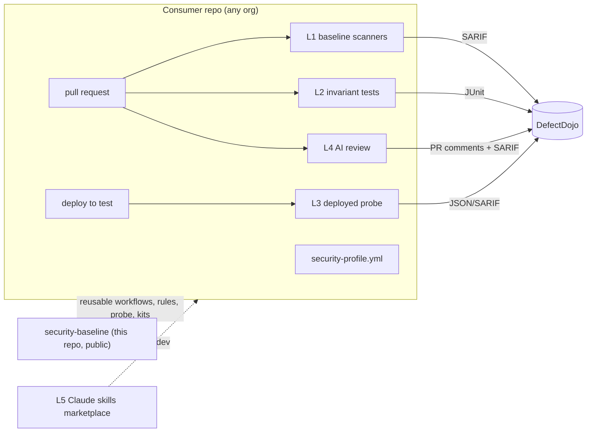

# Security Baseline — plan

**Status:** accepted, not built (2026-10-20). Owner: Stanislav Krása.
Nothing described here exists yet — this document is the target.

## 1. Why

Across our products, a run of serious security bugs was found **by accident**, not by any
control. Their classes:

| Class | Example shape | Would a generic scanner catch it? |
|---|---|---|
| Endpoint mounted without authentication, declared in an allowlist as "the handler authenticates itself" | a diagnostic endpoint registered only in a test environment, live for months | no |
| Broken object-level authorization (IDOR / BOLA) | route checks "is logged in", not "has access to this project" | no |
| Host / agent boundary | a client-supplied path bypasses the paths a shared resource is limited to | no |
| User content not encrypted at rest | one free-text column missed by the encryption rollout | no |
| Secret in source | a credential committed to a config file | **yes** |
| Defence in depth / token lifecycle | read-only enforced in the app only; refresh tokens without reuse detection | partly |

Generic tooling covers the one row that says "yes". The rest are **logic and authorization
invariants** — they need project-specific, mechanical checks, plus periodic review of OLD code
(a PR-diff review never sees a months-old endpoint).

This repo is the single, versioned home of those controls for **every project, in every GitHub
organization, on every stack** we run.

## 2. Scope

| Dimension | In scope |
|---|---|
| Stacks | .NET (ASP.NET Core), Java Spring Boot, React (SPA), Node.js/TypeScript (Express) |
| CI | GitHub Actions only |
| Organizations | `expertni-sluzby` (home of this repo) and the other organizations our projects live in |
| Findings store | DefectDojo, self-hosted, one instance for all organizations |

Out of scope for now: mobile, other CI systems, runtime protection (WAF/RASP).

## 3. The yardstick — OWASP

| Standard | Role here |
|---|---|
| **ASVS 5.0** | THE requirement set. Default target **Level 2**; Level 3 chapters for anything that executes code on a customer host or holds customer keys. Each consumer repo declares its applicable chapters in its profile (§5). |
| **API Security Top 10 (2023)** | Classification for API findings (BOLA, BFLA, …). |
| **Top 10:2025** | Classification / awareness. A01 Broken Access Control is our dominant class. |
| **Top 10 for Agentic Applications (2026)** + **LLM Top 10** | Additional checklist for AI-agent products. |
| **SAMM** | Yearly process-maturity assessment per project/team. |
| **WSTG** | Manual / pentest test cases. |
| **Cheat Sheet Series** | Source material for the skills (§7.5). |
| **CycloneDX** | SBOM format emitted by every build. |
| **DefectDojo** | Findings aggregation (§9). |

## 4. Architecture — five layers, one findings store



| Layer | What | Runs | Fails the build on |
|---|---|---|---|
| L1 | Generic scanners: secrets, dependencies, IaC/images, SAST with our rule packs | every PR + nightly | new HIGH/CRITICAL, any verified secret |
| L2 | Per-stack **invariant kits** — tests inside the consumer's own test suite | every PR | any violation (they are tests) |
| L3 | **Deployed probe** — black-box HTTP against the real test environment | after every deploy to test | any unauthenticated 2xx, any cross-tenant 2xx |
| L4 | AI security review of the PR diff + scheduled full-repo AI audit | PR / monthly | advisory on PR; audit findings go to DefectDojo |
| L5 | Claude Code skills for developers | locally, on demand | — |

## 5. Consumer contract

Each consumer repo adds:

```yaml
# security-profile.yml (repo root)
product: example-api             # DefectDojo product name
productType: example-org         # DefectDojo product type = GitHub organization
stack: [node-express, react]     # selects L1 rule packs and the L2 kit
asvs:
  level: 2
  level3Chapters: [V8, V11]      # example: authorization, cryptography
  notApplicable: [V17]           # each with a one-line reason under `reasons:`
invariantsFile: .claude/rules/security.md   # project-specific invariants for L4/L5
probe:
  openapi: docs/openapi.yaml
  baseUrl: https://test.example.com
  publicRoutes: security/public-routes.yml  # the reviewed allowlist (§7.2 I4)
```

…and one workflow:

```yaml
# .github/workflows/security.yml
permissions:
  contents: read
  security-events: write
  pull-requests: write
jobs:
  baseline:
    uses: expertni-sluzby/security-baseline/.github/workflows/baseline.yml@v1
    secrets:                       # explicit — never `secrets: inherit`
      DEFECTDOJO_TOKEN: ${{ secrets.DEFECTDOJO_TOKEN }}
      ANTHROPIC_API_KEY: ${{ secrets.ANTHROPIC_API_KEY }}
```

Branch rulesets in the consumer's organization make `baseline` a required check.

## 6. Distribution and the security of this repo — decided

**Decision (2026-10-20): this repo is public.** On the GitHub Team plan a private repo's
reusable workflows cannot be called from another organization; public is the only option that
needs no per-org mirrors or duplicated workflow logic. It also lets anyone add the skills
marketplace with one command.

**Public mechanism, private data:**

| Public (here) | Private (consumer repos, org settings) |
|---|---|
| reusable workflows, generic Semgrep rules, invariant kits, probe, skills | `security-profile.yml`, `public-routes.yml`, project invariants |
| examples with `example.com` and fictional products | real URLs, test identities, product names where sensitive |
| | DefectDojo + Anthropic tokens (org-level Actions secrets) |
| | **any rule that detects a not-yet-fixed vulnerability** — stays in the consumer repo until the fix is deployed, then may be generalized here |
| | incident details, audit reports, findings |

**This repo is a supply-chain target** — every consumer hands it secrets. Controls:

1. Consumers pass secrets **explicitly**, never `secrets: inherit`; only the two tokens above.
2. Rulesets: `main` requires a CODEOWNERS review, no force-push; tags `v*` cannot be moved or
   deleted, and are created only by the release workflow. Signed commits and tags.
3. Consumers pin the major tag `@v1`; high-assurance consumers pin a commit SHA and take
   updates through Renovate/Dependabot PRs.
4. Inside this repo: third-party actions pinned by SHA; minimal `permissions:`; never
   `pull_request_target`; Actions on fork PRs require maintainer approval.
5. On this repo (free because public): secret scanning, push protection, CodeQL, Scorecard.
6. Versioning: semver; release notes per tag; a rule change that can newly fail consumers'
   builds is a minor bump announced in advance, a contract change (§5) is a major bump.
7. Release provenance: release artifacts (probe binary, kit packages, container image) carry
   GitHub artifact attestations (`actions/attest`; available on Team because this repo is
   public); consumers verify with `gh attestation verify`.

**Applied 2026-10-20:** CODEOWNERS; rulesets `main-protection` (PR + code-owner review, no
force-push/deletion; admin may merge own PR, never push directly), `release-tags-immutable`
(`v*` cannot be updated or deleted — no bypass), `release-tags-creation` (only admins create
`v*`); secret scanning + push protection + validity checks; Dependabot alerts and security
updates; default `GITHUB_TOKEN` read-only; Actions on PRs from all external contributors need
approval. **Not yet:** required signed commits (enable once maintainers sign); tag creation by
the release workflow (GitHub does not allow the built-in Actions integration as a ruleset
bypass actor — needs an org-installed GitHub App; until then an admin tags releases).

## 7. Layer details

### 7.1 L1 — baseline scanners

| Concern | .NET | Spring Boot | React | Node/Express |
|---|---|---|---|---|
| Secrets | Gitleaks (pre-commit + CI, full history on first run), TruffleHog `--only-verified` in CI — all stacks |||
| Dependencies | osv-scanner (`packages.lock.json`) | osv-scanner (Maven/Gradle) | osv-scanner (npm lockfile) | osv-scanner (npm lockfile) |
| SAST | Semgrep (C#) + our pack | Semgrep (Java) + our pack; SpotBugs + FindSecBugs | Semgrep (TS/React) + our pack | Semgrep (TS) + our pack |
| IaC / images | Trivy `fs` + `config` (Dockerfile, Helm, k8s manifests) + `image` on built images — all stacks |||
| SBOM | CycloneDX generated per build — all stacks |||
| Repo hygiene | OpenSSF Scorecard (public repos free; private needs GitHub Code Security) |||
| CI workflows themselves | **zizmor** on `.github/workflows/**` (template injection, unpinned actions, excessive permissions, persisted checkout credentials, `pull_request_target`) + **Harden-Runner** (egress audit → block allowlist) on every baseline job — all repos, including this one |||

GitHub-native extras for private consumer repos (push protection, CodeQL) need the paid GitHub
Secret Protection / Code Security add-ons on the Team plan — **verify current pricing before
deciding**; L1 does not depend on them.

**Our Semgrep rule packs** (`rules/semgrep/<lang>/`), each rule with positive + negative fixtures:

- endpoint without an auth requirement (per framework idiom);
- data access by id with no tenant/owner predicate (EF Core `Find` / `FirstOrDefault(x => x.Id == id)`,
  Spring Data `findById`, Prisma `findUnique({ where: { id } })`);
- fallback secrets (`?? "secret"`, `|| 'secret'`, `@Value("${x:default}")` on secret keys);
- endpoint registration conditional on an environment name;
- file-system access with a path derived from a request or message;
- React: `dangerouslySetInnerHTML`, tokens in `localStorage`, credential-looking `VITE_*` /
  `REACT_APP_*` keys.

### 7.2 L2 — invariant kits (tests the consumer runs)

The same invariants, implemented idiomatically per stack. Each kit ships as a package
(NuGet / Maven / npm) plus a copy-paste template.

| Invariant | .NET (ASP.NET Core) | Spring Boot | Node/Express | React |
|---|---|---|---|---|
| **I1 Deny by default** | `AuthorizationOptions.FallbackPolicy = RequireAuthenticatedUser()`; test asserts it is set | `SecurityFilterChain` ends with `anyRequest().authenticated()`; test asserts it | global auth middleware before routers; test asserts order | — |
| **I2 Endpoint inventory** | integration test (`WebApplicationFactory`) enumerates `EndpointDataSource`; every endpoint has `IAuthorizeData` or is `[AllowAnonymous]` AND listed in `public-routes.yml` | `@SpringBootTest` enumerates `RequestMappingHandlerMapping.getHandlerMethods()`; unauthenticated MockMvc call → 401/403 unless listed | walk the router stack; same rule | — |
| **I3 No environment-gated endpoints** | inventory under `Production` AND `Development`/`Test` must be identical except an explicit, reviewed list | same, per Spring profile | same, per `NODE_ENV` | — |
| **I4 Allowlist claims are reviewed** | every `public-routes.yml` entry carries `reason`, `reviewedBy`, `reviewedAt`; a new entry fails CI until filled | same | same | — |
| **I5 Client hygiene** | — | — | — | built bundle scanned by Gitleaks; no auth token in `localStorage`; CSP present (checked by L3) |

I2–I4 together target the first row of §1: an endpoint that exists only in one environment and
is waved through by an unverifiable allowlist claim.

### 7.3 L3 — deployed probe

A small stack-agnostic CLI in this repo (`probe/`), driven by the consumer's OpenAPI document
(Swashbuckle/NSwag for .NET, springdoc-openapi for Spring):

1. **Unauthenticated sweep** — every operation, no credentials → expect 401/403 unless listed in
   `public-routes.yml`. Catches drift between code and deployed configuration (Helm values,
   gitops repos) that L2 cannot see.
2. **Cross-tenant replay** — two seeded test identities in two tenants; every operation taking
   an object id is called by tenant B with tenant A's ids → expect 403/404.
3. **Headers** — HSTS, CSP, cookie flags on the SPA and API origins.
4. **ZAP** — passive baseline against the SPA and API scan against the OpenAPI document, nightly.

Safety: runs against **test** environments. Against production only step 1, `GET`/`HEAD` only,
with an explicit per-product opt-in. Never writes; the two identities are dedicated fixtures.

### 7.4 L4 — AI review

- **PR:** `anthropics/claude-code-security-review` with the consumer's `invariantsFile` and ASVS
  profile as custom instructions. Advisory (comments), never a hard gate.
- **The AI job is itself an attack surface.** In 2026, prompt injection via PR titles, issue
  bodies and comments was shown to make AI review agents in CI — this action included
  (CVE-2026-54316) — leak workflow secrets. The PR review therefore runs under these
  constraints, enforced in `baseline.yml`, not left to consumers:
  1. trigger `pull_request` only — never `pull_request_target`, `issue_comment`, `issues`;
  2. the AI job holds exactly one secret (the Anthropic key, a dedicated low-limit key per
     organization) and a read-only `GITHUB_TOKEN`; no DefectDojo token, no deploy credentials;
  3. it writes its findings to an artifact; a separate, non-AI job with
     `pull-requests: write` posts them — the model never holds a write token;
  4. Harden-Runner egress in **block** mode with an allowlist (Anthropic API, GitHub API);
  5. fork PRs need maintainer approval (org setting); the action is pinned by SHA and its
     security advisories are tracked — a fix is adopted within the High SLA (§8).
- **Scheduled full-repo audit (monthly, and after any security incident):** class-driven —
  inventory → one hunter per class (classes = ASVS chapters in the profile) → independent
  adversarial verification → DefectDojo. Models: inventory Sonnet 5.5; hunt and verification
  Opus 5.5, the verifier always a separate instance from the finder. Haiku is never used for
  security judgement. Audit output is private (DefectDojo / consumer repo), never committed here.

### 7.5 L5 — Claude Code skills marketplace

This repo doubles as a plugin marketplace (`.claude-plugin/marketplace.json`):
`/plugin marketplace add expertni-sluzby/security-baseline`.

| Plugin | Does |
|---|---|
| `security-audit` | ASVS-chapter-driven audit of a path or the whole repo; reads the consumer's profile + invariants file |
| `variant-hunt` | "this bug was found — find its siblings here and in the listed sibling repos" (builds on Trail of Bits `variant-analysis`) |
| `add-invariant` | turn a confirmed finding into an L2 test or a Semgrep rule with fixtures, for the repo's stack |
| `security-triage` | pull open DefectDojo findings for the current product, propose fixes |

Recommended alongside: `trailofbits/skills`, the built-in `/security-review`.

## 8. Finding lifecycle (the process that makes it work)

Every finding, whatever found it:

1. **Fix.**
2. **Variant hunt** — the same class elsewhere in this repo and in sibling repos on the same
   stack. Historically the step done only by luck.
3. **Enforcer** — an L2 test, a Semgrep rule, or a probe check, so the class cannot return. If
   impossible, record why.
4. **Record** in DefectDojo (and in the product's own compliance register, where it has one).

SLA by severity (proposal): Critical 24 h, High 7 days, Medium 30 days, Low 90 days.

A leaked secret is never "fixed" by deleting it from the code: rotate first, then purge, then
check the provider's access logs for use during the exposure window.

## 8a. Governance around the tooling

| Practice | Content |
|---|---|
| **NIST SSDF (SP 800-218)** as the process frame | Map each layer to SSDF practices (PO / PS / PW / RV) once; DefectDojo + the consumer profiles become the SOC 2 / ISO 27001 evidence for secure development (ISO 27001:2022 A.8.25–A.8.31). Build the mapping from the NIST text, not vendor crosswalks. |
| **Security champions** | One developer per team (roughly 1 per 8–12 developers), ~10–20 % time: owns the team's profile, triages its DefectDojo findings, runs the variant hunt (§8 step 2). Not a substitute for a security review of high-risk changes. |
| **Lightweight threat modeling** | Mandatory for a new service, a new trust boundary (new client type, agent, external integration) or a new tenant-crossing feature: a one-page STRIDE note (OWASP Threat Dragon or markdown) in the consumer repo, reviewed by the champion. |
| **External pentest** | Yearly per product (WSTG-based), plus after a major architecture change; results into DefectDojo. Required anyway for SOC 2 / ISO 27001 evidence. |
| **SAMM** | Yearly self-assessment per team (§3); the scores drive the next year's rollout priorities. |

## 9. DefectDojo — self-hosted (decided 2026-10-20)

DefectDojo will hold every organization's open vulnerabilities — it is the most sensitive system
in this design and is treated as such.

| Item | Decision |
|---|---|
| Deployment | our own Kubernetes cluster, official Helm chart; PostgreSQL with backups and a tested restore. The URL reaches consumers as the org-level Actions variable `DEFECTDOJO_URL` — never hard-coded in this public repo |
| Cluster bar | the cluster hosting DefectDojo must meet production controls (restricted admin access, backups, monitoring, patching) — it stores every organization's open vulnerabilities, so a test-grade cluster is not acceptable |
| Human access | SSO only, behind VPN / identity-aware proxy; never an open login page on the internet |
| CI access | GitHub-hosted runners need to reach the API. Expose **only** `/api/v2/` import endpoints through a separate ingress with token auth (+ an identity-aware proxy service token or mTLS); the UI stays private. Alternative: self-hosted runners inside the network — **open decision** |
| Hierarchy | Product Type = GitHub organization · Product = repo/service · Engagement = CI/CD (one long-lived per branch) |
| Ingest | `reimport-scan` API from the baseline workflow with auto-create context, so dedup works across runs |
| Tokens | one API token per organization, scoped to that organization's product type, stored as an org-level Actions secret |
| Access model | per product type — an organization's members see only its own products |
| Operations | upgrades on a schedule; DefectDojo itself is a consumer of L1 (its image scanned by Trivy) |
| Reporting | monthly overview per organization; SLA breaches notify the product owner |

## 10. Rollout

| Phase | Content | Exit criterion |
|---|---|---|
| 0 | DefectDojo up (§9); repo skeleton + rulesets (§6); `baseline.yml` with L1 for all four stacks | L1 green on one repo per stack, findings visible in DefectDojo |
| 1 | **Pilot on a product with a known bug corpus:** L1 + Node kit (I1–I4) + probe step 1 | **Detection test:** on a throwaway branch, previously fixed bugs are re-introduced — the kit/probe must flag every one |
| 2 | .NET and Spring kits + probe step 2 (cross-tenant); React I5 | each kit catches a seeded unauthenticated endpoint and a seeded environment-gated endpoint in its fixture app |
| 3 | L4 PR review + first scheduled full audit per product; L5 marketplace | first audit's confirmed findings in DefectDojo with owners |
| 4 | All repos in all organizations; required check via rulesets; SAMM baseline per team | every active repo has a profile and a green required `baseline` |

The phase-1 detection test is the acceptance proof for the whole approach: a control that
cannot catch the bugs we already had is not a control. The corpus itself is private to the
pilot product.

## 11. Proposed repo layout

```
.github/workflows/      baseline.yml (reusable), probe.yml, audit.yml, release.yml
.claude-plugin/         marketplace.json
plugins/                security-audit/, variant-hunt/, add-invariant/, security-triage/
rules/semgrep/          csharp/, java/, typescript/, react/ (+ tests/)
kits/                   dotnet/, spring/, node-express/, react/
probe/                  OpenAPI-driven CLI
profiles/               JSON schema for security-profile.yml + examples
defectdojo/             compose/helm values, product-type bootstrap script
docs/                   PLAN.md (this), decisions/
```

## 12. Open decisions

1. ~~Distribution~~ — public repo (§6).
2. ~~DefectDojo hosting~~ — self-hosted on our own cluster (§9). Still open: CI reachability
   (public import-only ingress vs self-hosted runners); confirm the cluster meets the §9 bar.
5. GitHub App for the release workflow (tag creation, §6).
3. Licensing GitHub Secret Protection / Code Security for private consumer repos (optional).
4. SLA values in §8.

## Sources

- OWASP Top 10:2025 — https://owasp.org/Top10/2025/
- OWASP ASVS 5.0 overview — https://softwaremill.com/whats-new-in-asvs-5-0/
- OWASP Top 10 for Agentic Applications 2026 — https://genai.owasp.org/resource/owasp-top-10-for-agentic-applications-for-2026
- DefectDojo — https://docs.defectdojo.com/ · overview https://appsecsanta.com/defectdojo
- Claude Code GitHub Actions — https://docs.anthropic.com/en/docs/claude-code/github-actions
- Trail of Bits skills — https://github.com/trailofbits/skills
- Gitleaks vs TruffleHog — https://www.jit.io/blog/trufflehog-vs-gitleaks-a-detailed-comparison-of-secret-scanning-tools
- ZAP API scanning — https://qaskills.sh/blog/owasp-zap-api-security-testing-guide-2026
- Broken access control in CI — https://www.wiz.io/api/md/academy/application-security/broken-access-control
- AI coding agents in CI, prompt injection → secrets — https://labs.cloudsecurityalliance.org/research/csa-research-note-ai-coding-agent-ci-prompt-injection-202608/
- zizmor at scale (Grafana) — https://grafana.com/blog/2025/06/25/how-to-detect-vulnerable-github-actions-at-scale-with-zizmor/
- StepSecurity Harden-Runner / secure workflow — https://docs.stepsecurity.io/orchestrate-security/secure-workflow
- GitHub artifact attestations — https://docs.github.com/actions/security-guides/using-artifact-attestations-to-establish-provenance-for-builds
- NIST SSDF — https://www.nist.gov/document/eo-14028-presentation-nist-secure-software-development-framework-ssdf
- Security champions — https://appsecsanta.com/application-security/security-champions-guide
